<div align="center">

# report-anything

**Agents write the report. The engine lays it out.**

A headless report engine for AI agents: describe *what* to show as JSON, get a validated, paginated,<br/>data-bound report for the web and for print — streamed live into the conversation.

[](https://jaesang1998.github.io/report-anything/)
[](https://github.com/JaeSang1998/report-anything/actions/workflows/pages.yml)
[](LICENSE)


[**Open the playground →**](https://jaesang1998.github.io/report-anything/)<br/>
<sub>No API key needed. Pick a sample, ask for a report, watch it build.</sub>

<br/>

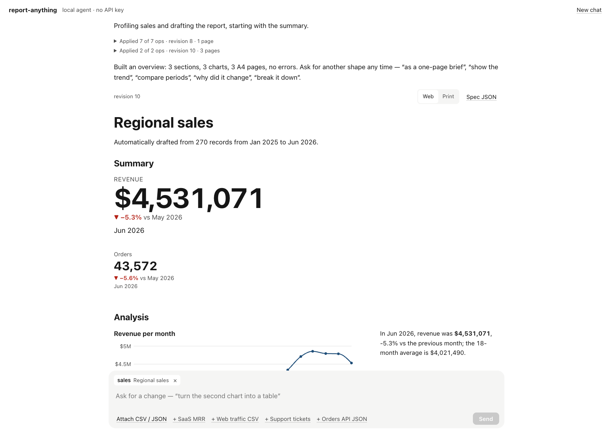

</div>

<br/>

## Why

Asking an LLM for "a report" usually gets you one of two things: a wall of markdown, or a pile of generated React that is different every time and quietly invents numbers.

report-anything splits the job the way a newsroom does:

| | Decides | Lives in |
| --- | --- | --- |
| **Agent** | *What* to show: datasets, sections, KPIs, chart encodings, narrative | a `ReportSpec` JSON (or a stream of edit ops) |
| **Engine** | *How* it fits: aggregation, grid spans, heights, page breaks, formatting | `@report-anything/core` — no DOM, no React |
| **Renderer** | Pixels | `@report-anything/react`, SVG, static HTML |

The agent never writes coordinates, CSS, or a single number. It writes intent; the engine guarantees the rest.

## What you get

<table>
<tr>
<td width="50%" valign="top">

**Numbers that can't be hallucinated**<br/>
KPIs, comparisons and prose placeholders are *bound* to data — `{ data, field, agg, where }` or `{{sum(sales.revenue) | currency:KRW}}` — and computed by the engine.

</td>
<td width="50%" valign="top">

**Any data in**<br/>
Flat rows, CSV, or nested API JSON (`{ meta, data: { orders: [...] } }` is found and flattened). A transform pipeline — filter, derive, aggregate, window, pivot, lookup — runs in the data layer.

</td>
</tr>
<tr>
<td valign="top">

**A layout engine, not a row packer**<br/>
A solver composes each section from 2D compositions — feature, sidebar, hero, grid, pairs — with row-spanning placements, elastic chart heights levelled across columns, and A4/Letter pagination with keep-with-next headers and split tables.

</td>
<td valign="top">

**Built for agents to iterate**<br/>
Id-addressed, transactional ops (`updateBlock`, `replaceBlock`, `moveBlock`, …) stream in as JSONL. Every issue comes back with a path and a fix: *"field 'revenu' is not in dataset 'monthly' — did you mean 'revenue'?"*

</td>
</tr>
<tr>
<td valign="top">

**Headless first**<br/>
Charts are renderer-agnostic scene graphs; tables, KPIs and comparisons are view models. Use the React adapter, the SVG serializer, or draw your own.

</td>
<td valign="top">

**A document, not a dashboard**<br/>
The default theme has no cards, tiles or pills — whitespace, type and table rules carry the structure. Web and print come from the same spec.

</td>
</tr>
<tr>
<td valign="top">

**A real chart vocabulary**<br/>
Bar, line, area, scatter, pie/donut, heatmap — plus `waterfall` (what changed), `funnel` (where people drop off) and `dumbbell` (before → after per category). Secondary axes, reference lines, stacking and percent stacks included.

</td>
<td valign="top">

**Diagrams next to data**<br/>
A `diagram` block takes Mermaid source — flowcharts, sequences, state machines, ER, timelines — and lays it out with the rest of the report.

</td>
</tr>
</table>

## Compositions, not rows

The layout engine treats each section as a sequence of **bands** on a 12-column grid. Blocks can span rows, so a lead chart can sit beside a stack of smaller blocks, and a short note can run alongside several charts as an aside. For every section a dynamic program tries the candidate compositions in reading order and keeps the cheapest:

| Composition | Shape | Chosen when |
| --- | --- | --- |
| `hero` | one block, display type | a `stat` or a lead chart opens the story |
| `feature-left` / `feature-right` | lead block over two rows + a stack of two | a chart/diagram/table with two smaller companions |
| `sidebar-left` / `sidebar-right` | a narrow aside running beside 2–4 stacked blocks | narrative or a stat that explains several views |
| `pair` | 6/6, 7/5, 5/7, 8/4, 4/8 | two blocks of comparable or complementary weight |
| `trio` · `quad` · `grid` | 4/4/4 · 3/3/3/3 · 2×2 / 2×3 equal tiles | compact peers (stats, short lists, small charts) |
| `full` · `stack` | 12 | KPI strips, wide tables, many-category charts, narrow print |

Costs it minimises: whitespace left after **levelling** (charts and diagrams have an elastic height range, so columns end level), `importance` mismatches (lead blocks get the largest area, supporting blocks become asides), poor pairings (chart + its note is good, two long texts side by side is not), monotony (repeating the same composition), and print fit. The agent states *importance* and, if it wants, a section `layout` hint; it never states coordinates.

<table>
<tr>
<td width="50%">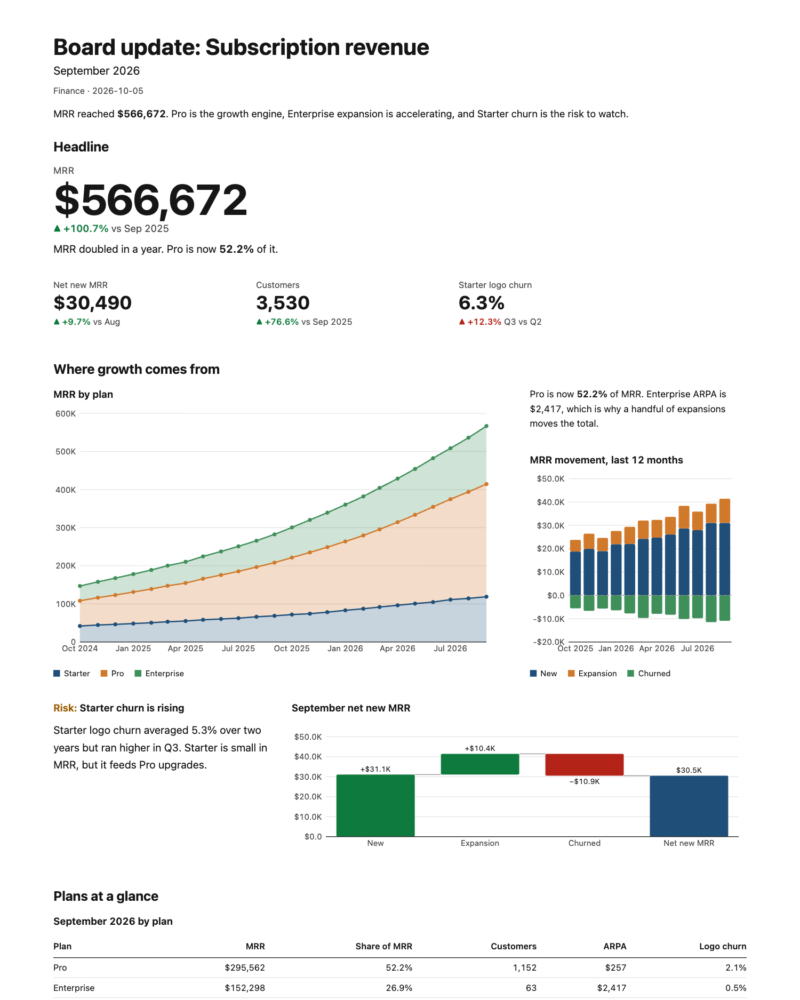</td>
<td width="50%">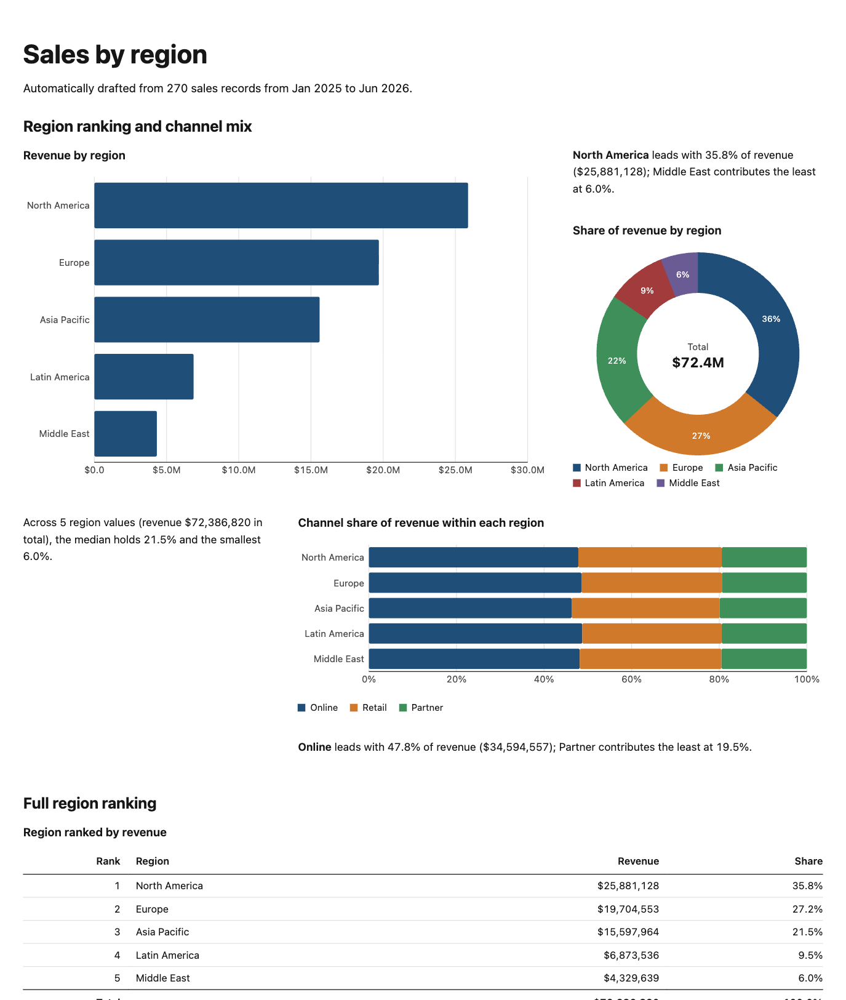</td>
</tr>
<tr>
<td align="center"><sub>Hero stat, then a lead area chart beside a stacked note and chart (<code>feature-right</code>)</sub></td>
<td align="center"><sub>Ranking as the lead with its note and donut stacked; a note as an aside to the mix chart (<code>sidebar-left</code>)</sub></td>
</tr>
</table>

Small multiples are part of the vocabulary too: `chart.facet` draws one mini chart per category with shared axes, sized by the same solver.

## One dataset, six shapes

A report should be shaped by its question. `autoReport` (CLI: `report-anything auto --shape …`, playground: just ask) drafts six different structures from the same data — here, the regional sales sample:

<table>
<tr>
<td width="33%" valign="top">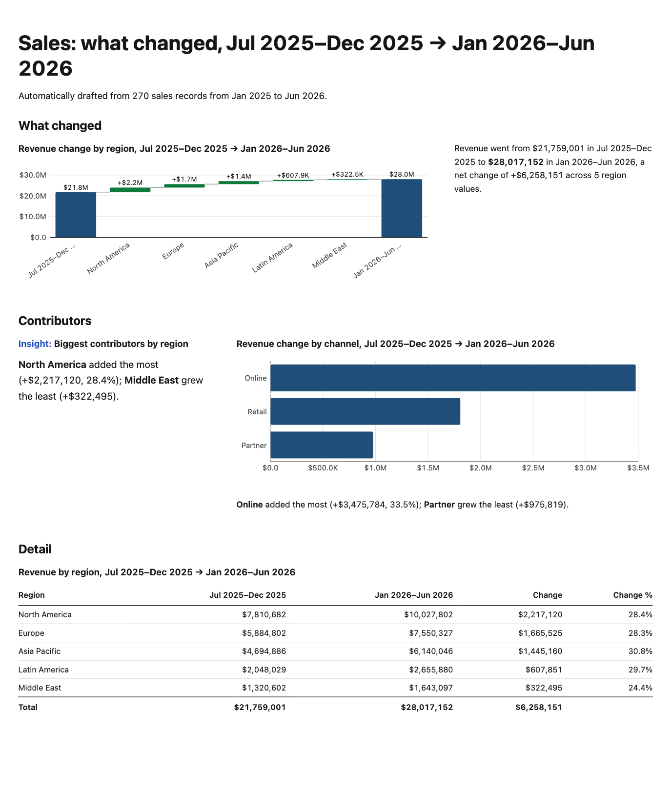<br/><b>bridge</b> · <sub>“Why did revenue change?” — waterfall by contributor, top movers</sub></td>
<td width="33%" valign="top">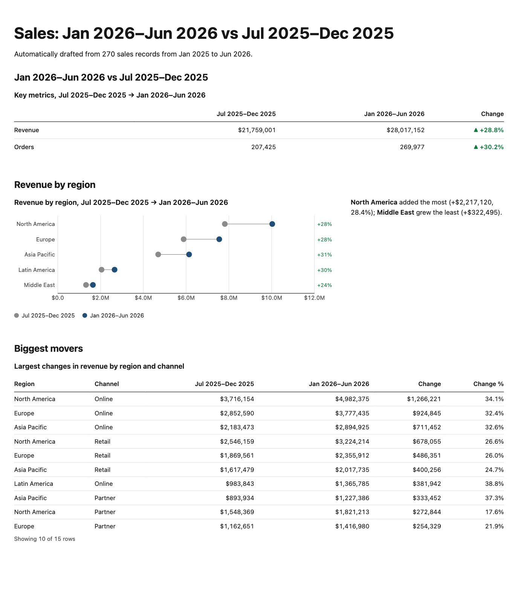<br/><b>compare</b> · <sub>“This half vs last” — comparison, dumbbell, biggest movers</sub></td>
<td width="33%" valign="top">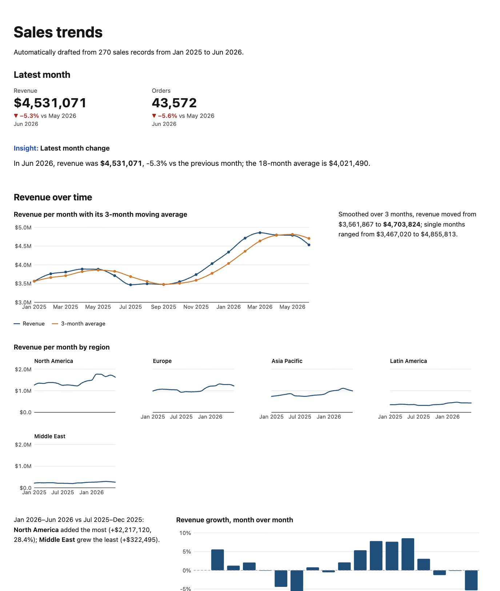<br/><b>trend</b> · <sub>“How is it trending?” — moving average, growth, best/worst periods</sub></td>
</tr>
<tr>
<td valign="top"><br/><b>breakdown</b> · <sub>“Where does it come from?” — ranking, shares, mix</sub></td>
<td valign="top">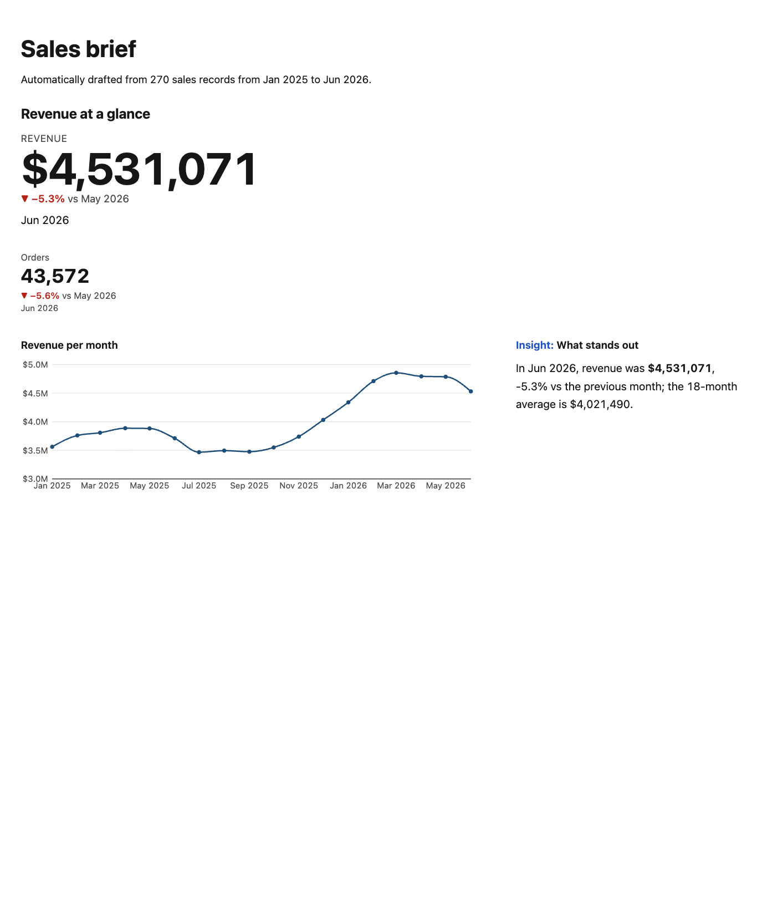<br/><b>brief</b> · <sub>“One page for the board” — KPIs, one chart, one insight</sub></td>
<td valign="top">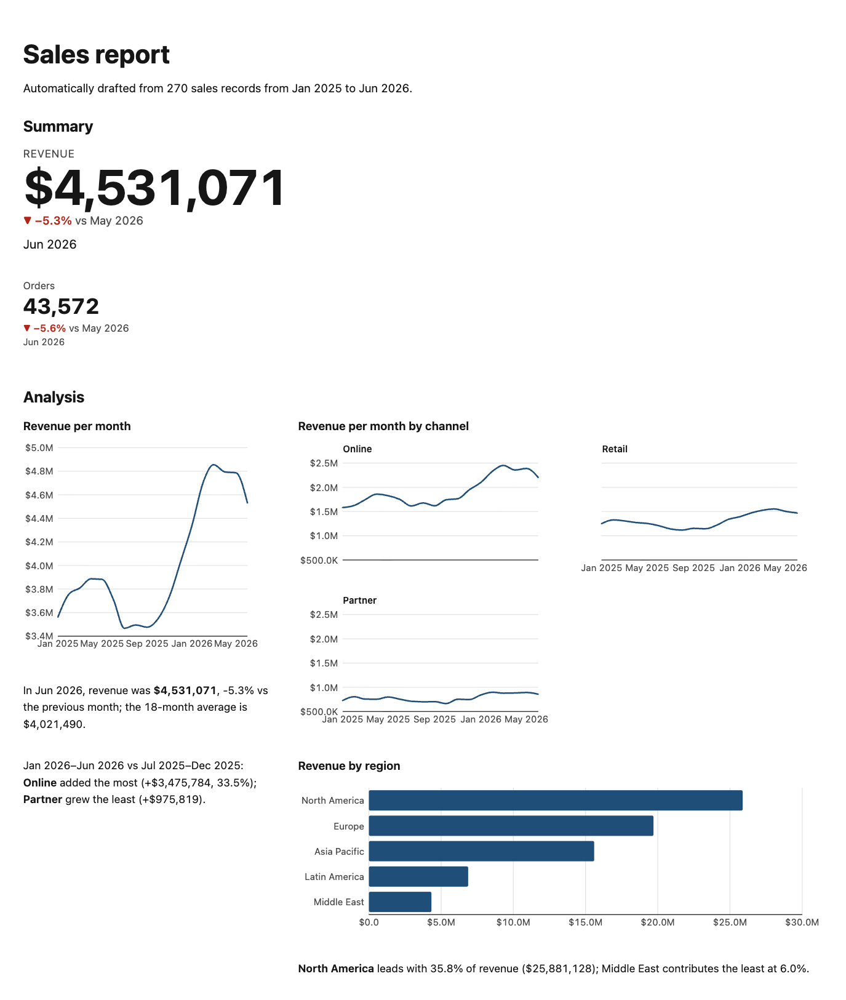<br/><b>overview</b> · <sub>Default — KPIs, a few views, detail table</sub></td>
</tr>
</table>

## The playground

The report is written **into the conversation**. While the agent streams its ops, the report builds up inside its reply; every later edit produces a new version, and earlier versions stay in the thread.

<table>
<tr>
<td width="50%">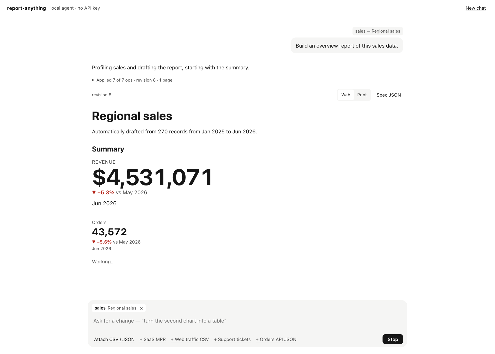</td>
<td width="50%">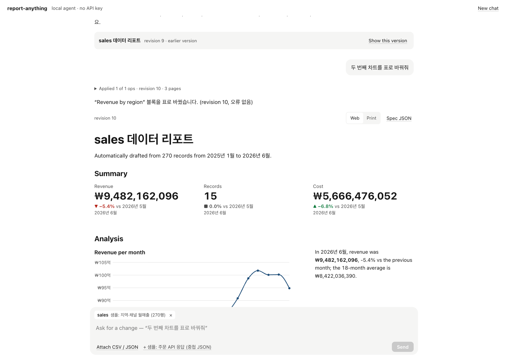</td>
</tr>
<tr>
<td align="center"><sub>Building live — ops apply while the model is still writing them</sub></td>
<td align="center"><sub>"Make the first chart a bar chart" — earlier versions stay in the thread</sub></td>
</tr>
</table>

- **[Hosted playground](https://jaesang1998.github.io/report-anything/)** runs a keyless local agent entirely in your browser: it builds reports from your CSV/JSON (nothing is uploaded) in the shape your question implies ("why did…" → bridge, "compare…" → comparison, "one-page…" → brief), handles a fixed set of edits — chart type, chart → table, horizontal, stacked, remove a block, rename — and turns a pasted ```` ```mermaid ```` block into a diagram.
- **Locally with a key**, the same UI talks to Claude or GPT through the AI SDK. The system prompt *is* the [agent skill](skills/report-anything/SKILL.md); the browser owns the report session and executes the agent's tools, so the model always sees the real validation and layout result.
- **See what the agent sees.** Click any data chip to open the dataset: the table the engine actually works on (after CSV parsing, JSON flattening and transforms), the raw source, and each field's inferred type and role.

Five sample datasets, deliberately different in shape:

| Sample | Shape | What it exercises |
| --- | --- | --- |
| Regional sales | flat rows, month × region × channel | year-over-year deltas, shares, channel mix |
| SaaS MRR | monthly snapshots by plan | stock vs flow measures (MRR is never summed across months), churn rates |
| Web traffic | **CSV text**, weekly channel × device | derived conversion rate (signups / sessions), weekly trends |
| Support tickets | event records with nulls | counts as the headline, medians, durations where lower is better |
| Orders API | **nested JSON** (`{ meta, data: { orders: [{ customer: {…}, items: [...] }] } }`) | record-array detection, dotted fields, exploded line items |

<table>
<tr>
<td width="50%">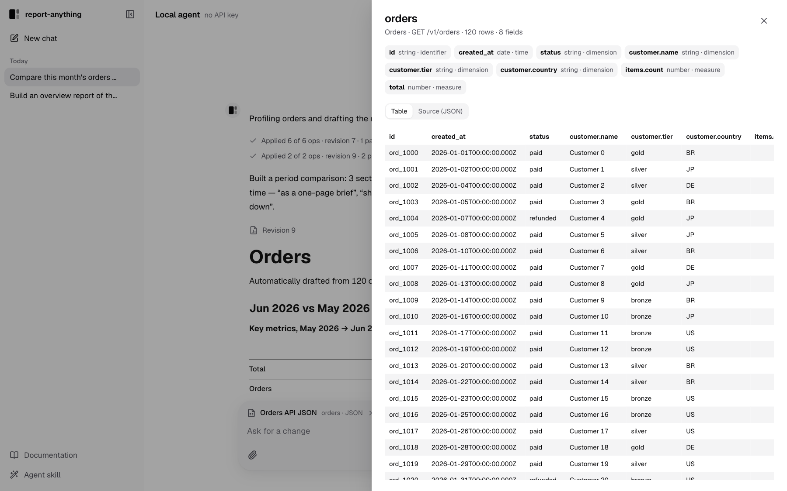</td>
<td width="50%">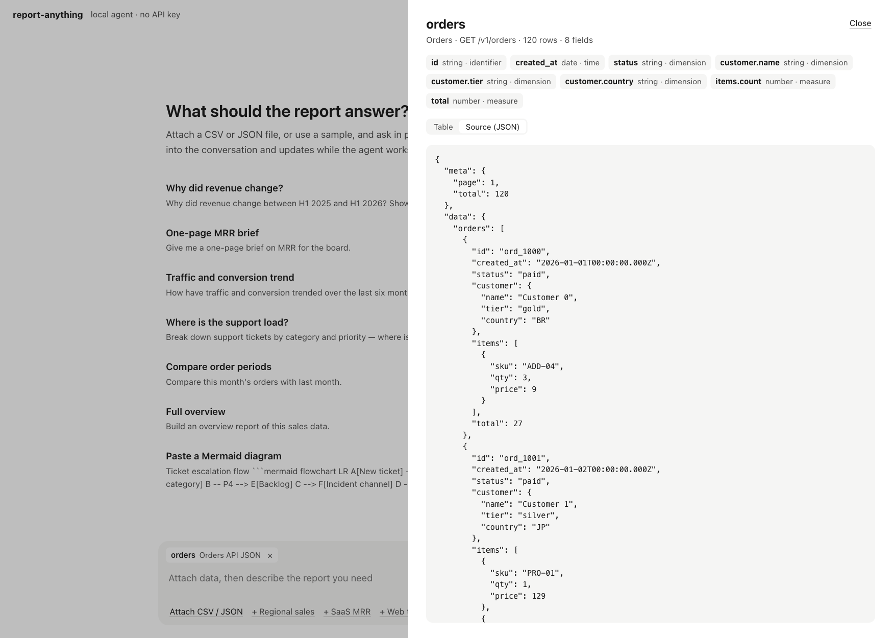</td>
</tr>
<tr>
<td align="center"><sub>Nested API JSON, as the engine sees it</sub></td>
<td align="center"><sub>…and the raw source it came from</sub></td>
</tr>
</table>

```sh
pnpm install && pnpm dev                  # http://localhost:5173 — local agent, no key
echo "ANTHROPIC_API_KEY=sk-..." > examples/playground/.env.local   # or OPENAI_API_KEY
pnpm dev                                  # same UI, LLM agent
```

## Thirty seconds of ReportSpec

```jsonc
{
  "title": "Q2 sales",
  "meta": { "locale": "en-US", "currency": "USD" },
  "datasets": {
    "sales": { "csv": "month,region,revenue\n2026-04,EU,120\n2026-04,US,200\n…" },
    "monthly": {
      "from": "sales",
      "transform": [
        { "op": "aggregate", "groupBy": ["month"], "measures": [{ "field": "revenue", "agg": "sum", "as": "revenue" }] },
        { "op": "window", "fn": "pctChange", "field": "revenue", "as": "growth", "sortBy": "month" }
      ]
    }
  },
  "sections": [{
    "id": "summary",
    "title": "Summary",
    "blocks": [
      { "id": "kpis", "type": "kpi", "items": [{ "label": "June revenue", "value": { "data": "monthly", "field": "revenue", "agg": "last" }, "format": "currency" }] },
      { "id": "trend", "type": "chart", "title": "Revenue by month",
        "chart": { "kind": "bar", "data": "monthly", "x": "month", "y": "revenue", "secondary": { "y": "growth", "format": "percent" } } },
      { "id": "why", "type": "callout", "variant": "insight", "content": "June closed at {{last(monthly.revenue) | currency}}." }
    ]
  }]
}
```

No spans, no heights, no page breaks — the engine pairs the chart and the callout 8/4 on the web, re-flows them for A4, and formats every number from the data.

## Examples

Four hand-written specs in [`examples/specs`](examples/specs), each with its data embedded. Render any of them with `report-anything render <file> [--mode print]`.

<table>
<tr>
<td width="50%" valign="top"><a href="examples/specs/regional-sales.json">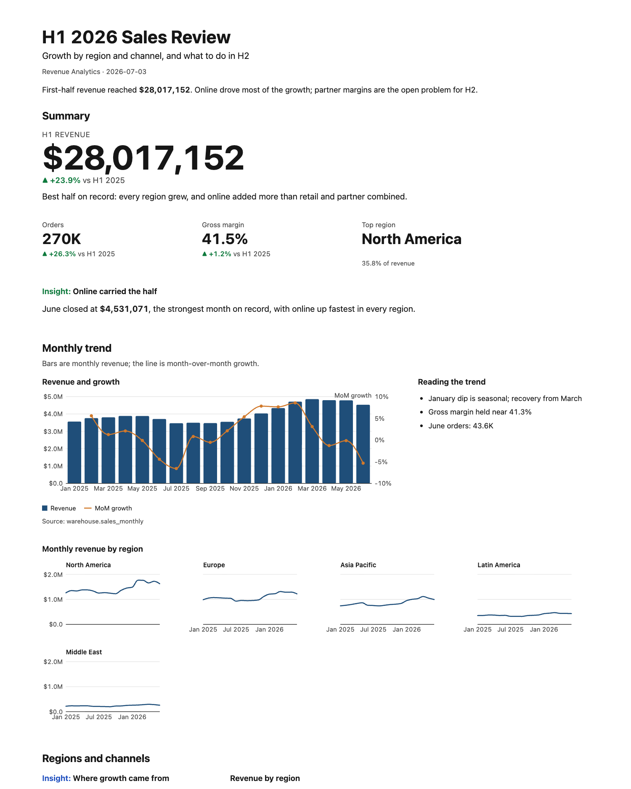</a><br/><b>H1 sales review</b><br/><sub>KPIs with year-over-year baselines, bars + growth on a second axis, horizontal and 100% stacked bars, comparison, totals, action list.</sub></td>
<td width="50%" valign="top"><a href="examples/specs/saas-board.json"></a><br/><b>SaaS board update</b><br/><sub>Stacked area by plan, MRR movement with churn below zero, a net-new-MRR waterfall, plan table with ARPA, board asks.</sub></td>
</tr>
<tr>
<td valign="top"><a href="examples/specs/growth-funnel.json">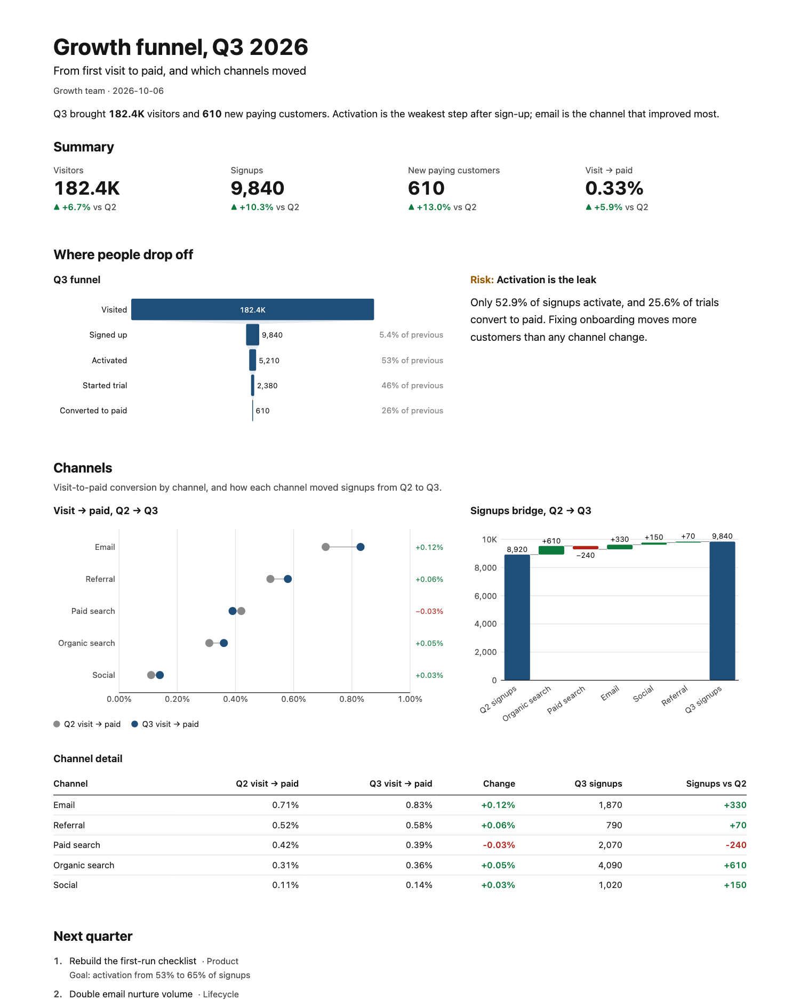</a><br/><b>Growth funnel</b><br/><sub>Funnel from visit to paid, dumbbell of conversion by channel (Q2 → Q3), signups bridge as a waterfall, signed deltas.</sub></td>
<td valign="top"><a href="examples/specs/support-review.json">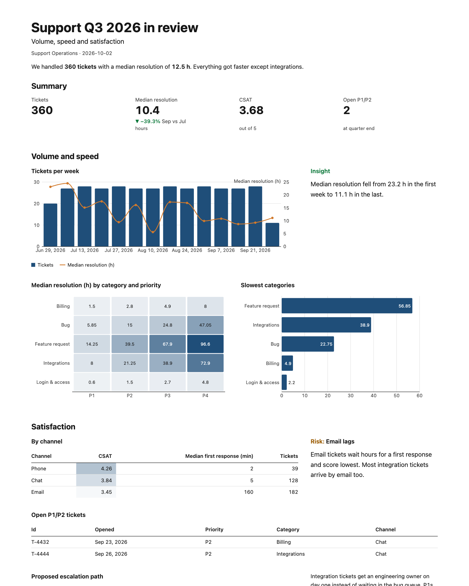</a><br/><b>Support quarter in review</b><br/><sub>Event data: counts and medians, resolution heatmap by category × priority, CSAT heat column, and an escalation flow as a Mermaid diagram.</sub></td>
</tr>
</table>

<table>
<tr>
<td width="50%">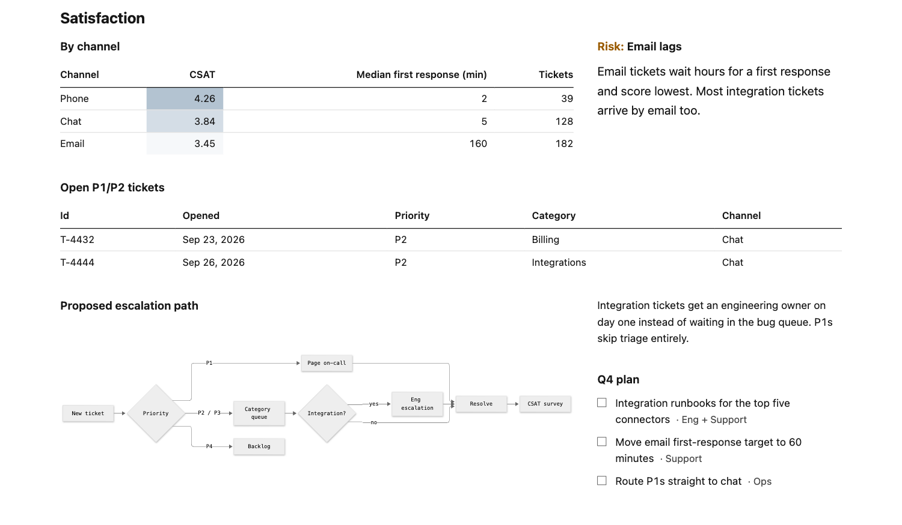</td>
<td width="50%">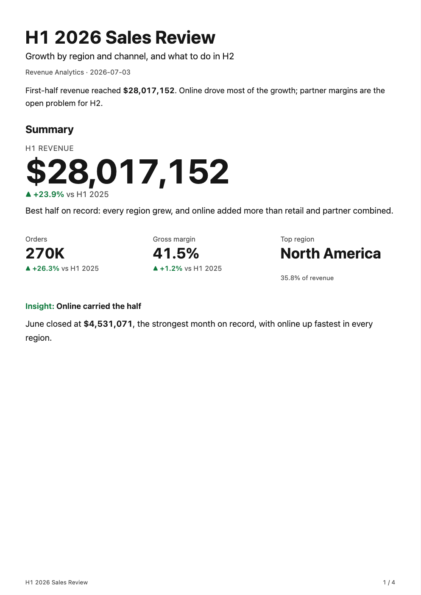</td>
</tr>
<tr>
<td align="center"><sub>A Mermaid flowchart laid out next to its explanation</sub></td>
<td align="center"><sub>Print mode: A4, paginated by the engine</sub></td>
</tr>
</table>

## How it works

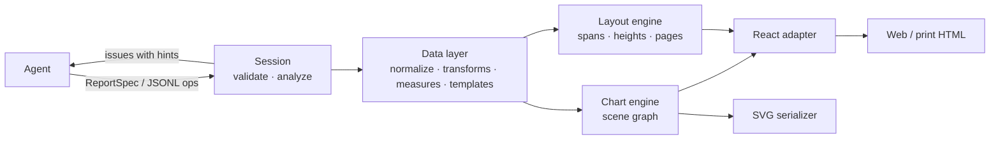

- **Compositions, solved.** A dynamic program walks each section's blocks in reading order and chooses compositions (feature, sidebar, hero, grid, pair, trio, quad, full) that minimise a cost: whitespace left after levelling elastic heights, importance mismatches, poor pairings, monotony, and print fit. Agents steer with `importance` and optional section `layout`; geometry stays the engine's job. Print and web differ because widths differ.
- **One source of metrics.** `METRICS` drives both the height estimator and the CSS variables; in print mode the React adapter measures real DOM heights and feeds them back to the paginator until they agree.
- **Transactional edits.** Ops either all apply or none do; semantic problems (an unknown field, a broken template) are accepted and reported per block, so a half-streamed report still renders everything that is valid.

## Packages

| Package | |
| --- | --- |
| [`@report-anything/core`](packages/core) | ReportSpec schema (Zod → JSON Schema), data normalization, transforms, safe expressions, measures and templates, chart scene graphs, layout + pagination, ops, sessions, JSONL streaming, `autoReport`. |
| [`@report-anything/react`](packages/react) | `<Report spec \| session mode="web" \| "print">`, per-block renderer overrides, `ChartView`, hooks, `styles.css`. |
| [`@report-anything/cli`](packages/cli) | `schema · validate · inspect · profile · auto · apply · render · chart` |
| [`skills/report-anything`](skills/report-anything) | Agent skill: workflow, editorial rules, spec cheat sheet. Drop it into Claude Code / Codex. |
| [`examples/playground`](examples/playground) | The chat playground (Vite + AI SDK). |

## Use it

**React**

```tsx
import { Report, useReportSession } from "@report-anything/react";
import "@report-anything/react/styles.css";

<Report spec={agentJson} mode="print" />;

// Streaming / incremental edits: apply ops as they arrive.
const session = useReportSession();
session.apply({ op: "addBlock", section: "summary", block: { id: "k", type: "kpi", items: [/* … */] } });
<Report session={session} />;

// Server-driven UI escape hatch: replace any block body, keep the layout.
<Report spec={spec} components={{ chart: MyEChartsBlock }} />;
```

**Headless**

```ts
import { createReportSession, layoutReport, buildChart, chartToSvg } from "@report-anything/core";

const session = createReportSession(spec);
session.apply(ops);                     // transactional; issues reported, not thrown
session.inspect({ mode: "print" });     // token-cheap outline for the agent
const { spec: s, context } = session.getSnapshot();
const plan = layoutReport(s, context, { mode: "print" });
```

**CLI** (from the repo: `node packages/cli/dist/bin.js …`)

```sh
report-anything profile orders.json                  # field roles, stats, chart suggestions
report-anything auto orders.json --shape bridge -o spec.json   # overview|brief|trend|compare|breakdown|bridge
report-anything validate spec.json                   # schema + data checks, did-you-mean hints
report-anything inspect spec.json --mode print       # spans, heights, pages, layout diagnostics
report-anything apply spec.json edits.jsonl -o spec.json
report-anything render spec.json --mode print -o report.html
report-anything chart spec.json trend -o trend.svg
```

## Customizing

| Level | How |
| --- | --- |
| Colors & palette | `--ra-*` CSS variables, or `spec.theme` (`palette`, `accent`, `density`) |
| Sizes | `METRICS` in core — they also drive the layout estimator, so change them there |
| One block type | `<Report components={{ chart: MyChart }} />` |
| Everything | Build on the headless models: `buildChart`, `buildTableModel`, `buildKpiModels`, `layoutReport` |

## Develop

```sh
pnpm install
pnpm build        # core → react → cli (tsc -b)
pnpm test         # vitest
pnpm typecheck
pnpm dev          # playground
```

## Roadmap

- **Code authoring** — a typed TS/TSX builder that compiles to the same ReportSpec, for people who would rather write code than JSON.
- **PDF** via Playwright, with hydrated HTML so print pagination uses measured heights.
- **More renderers** from the same IR: PPTX / DOCX, Typst.
- **MCP server** exposing session `apply` / `inspect` / `render`.
- **shadcn-style distribution** — copy-in block components that follow your app's theme.

## License

[Apache-2.0](LICENSE)
